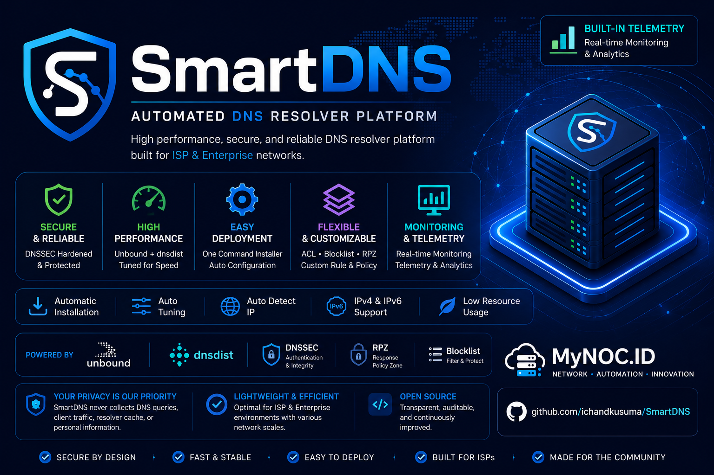

<div align="center">



# SmartDNS

### High Performance Recursive DNS Platform powered by **Unbound** and **dnsdist**

Developed and maintained by [**MyNOC.ID**](https://mynoc.id)


</div>

---

<div align="center">

### 🌐 Documentation Language

**🇮🇩 [Bahasa Indonesia](#-bahasa-indonesia)** &nbsp;&nbsp; | &nbsp;&nbsp; **🇬🇧 [English](#-english)**

</div>

---

# 🇮🇩 Bahasa Indonesia

## Tentang SmartDNS

SmartDNS adalah platform **DNS Resolver otomatis berperforma tinggi** yang dirancang untuk lingkungan:

- ISP
- Enterprise
- VPS
- Self-Hosted
- Network Infrastructure

SmartDNS dibangun menggunakan **Unbound** sebagai recursive DNS resolver dan **dnsdist** sebagai DNS load balancer / frontend.

Installer secara otomatis mendeteksi hardware server, menghitung konfigurasi tuning yang sesuai, memasang recursive DNS resolver, mengaktifkan fitur keamanan dan blocklist, serta menyiapkan monitoring dan scheduler.

Mulai dari **v1.0.0**, SmartDNS juga memiliki sistem **Telemetry dan Heartbeat** untuk membantu monitoring instalasi dan versi software.

---

## ✨ Fitur

### Smart Installer

- One Command Installation
- Automatic Hardware Detection
- Smart CPU & RAM Tuning
- Recursive DNS Resolver menggunakan Unbound
- High Performance DNS Load Balancer menggunakan dnsdist
- DNSSEC Validation
- DNS Packet Cache
- IPv4 & IPv6 Support
- DNS Blocklist
- Domain Whitelist
- Domain Insecure Support
- DNSDist Web Management
- Automatic Blocklist Update
- Automatic Health Check
- Automatic Timezone Configuration
- Automatic Hostname Configuration
- Smart Scheduler menggunakan Cron
- Interactive Installation Wizard

### Monitoring

- Automatic Heartbeat setiap 5 menit
- Built-in Telemetry
- Monitoring Dashboard
- Node Inventory
- Statistics Dashboard

### SmartDNS Management Web UI

SmartDNS kini dilengkapi **Web UI** untuk memantau dan mengelola layanan dari browser.

Fitur yang tersedia:

- **System Overview** — informasi server dan status layanan.
- **Real-time Monitoring** — CPU, RAM, swap, disk usage, disk I/O/wait, network RX/TX, dan PPS.
- **Domain Blocklist Search** — mencari domain pada blocklist.
- **DNSDist Configuration** — melihat dan mengelola konfigurasi DNSDist yang didukung UI.
- **Unbound Configuration** — melihat dan mengelola konfigurasi Unbound yang didukung UI.
- **Blocklist Sources** — melihat sumber blocklist.
- **Active Services** — memantau status service.
- **Live Analytics dan Query Log** — melihat aktivitas serta query DNS.
- **DNS Resolution Test Suite** — menjalankan pengujian resolusi DNS.
- **Tools & Maintenance** — akses ke tools pemeliharaan dan Patch Update SmartDNS.
- **GitHub Shortcut** — membuka repository SmartDNS.

Web UI tersedia di `http://IP-SERVER:5000`. Login menggunakan username `admin` dan password yang sama dengan DNSDist Web UI pada port `8083`.

---

## 🖥️ Operating System Support

SmartDNS **v1.0.3** telah diuji pada:

| Operating System | Status |
|---|:---:|
| Ubuntu 22.04 LTS | ✅ Supported |
| Ubuntu 24.04 LTS | ✅ Supported |
| Debian 12 | ✅ Supported |

---

## 📋 Minimum Requirements

| Component | Minimum |
|-----------|---------:|
| CPU | 2 Core |
| RAM | 2 GB |
| Storage | 10 GB SSD |
| Network | Public IPv4 |
| Root Access | Required |

---

## 🚀 Recommended Requirements

| Component | Recommended |
|-----------|-------------|
| CPU | 4 Core or Higher |
| RAM | 4 GB or Higher |
| Storage | 20 GB SSD |
| Network | IPv4 + IPv6 |
| OS | Ubuntu 22.04 LTS |

---

## 📦 Installation

Clone repository:

```bash
git clone https://github.com/ichandkusuma/SmartDNS.git
```

Masuk ke directory:

```bash
cd SmartDNS
```

Jalankan installer:

```bash
bash install.sh
```

Installer akan melakukan:

1. Detect operating system
2. Detect CPU dan RAM
3. Detect virtualization
4. Detect network interface
5. Detect Internet connectivity
6. Calculate Smart Tuning
7. Install required packages
8. Configure Unbound
9. Configure dnsdist
10. Install DNS blocklist
11. Configure scheduler
12. Configure telemetry
13. Validate configuration
14. Restart services
15. Run DNS health check

---

## 🔄 Updating SmartDNS

Pembaruan dan konfigurasi ulang:

```bash
cd SmartDNS
git pull
bash install.sh
```

Jika diminta untuk melakukan pembaruan paksa, gunakan perintah berikut.

```bash
cd SmartDNS
git fetch origin
git reset --hard origin/main
bash install.sh
```

---

## 🔄 Updating SmartDNS Patch

Untuk existing installation, update menggunakan:

```bash
cd SmartDNS
bash update.sh --patch
```

Existing installation akan mempertahankan:

- UUID
- Telemetry Data
- Runtime Information
- Existing Configuration
- Scheduler

---

## 🧙 Installation Wizard

Installer secara otomatis mengatur:

- Hostname
- Timezone
- CPU Threads
- Cache Size
- DNSSEC
- IPv6
- Packet Cache
- DNSDist Web Password
- DNSDist API Key
- Recursive Port
- Frontend Port
- Spoof IPv4
- Spoof IPv6
- Resolver ACL
- UUID
- Heartbeat Registration

---

## 🌐 Default Service Ports

| Service | Port |
|---------|-----:|
| DNS Resolver | 53 |
| Recursive Resolver | 5300 |
| DNSDist Web UI | 8083 |
| SmartDNS Management Web UI | 5000 |

---

## 🛡️ DNS Features

- DNSSEC Validation
- Recursive Resolver
- DNS Cache
- IPv4 & IPv6 Support
- DNS Blocklist
- Domain Whitelist
- Domain Insecure
- DNSDist Web UI

---

## 🚫 DNS Blocklist

SmartDNS menyediakan DNS blocklist yang dapat diperbarui secara otomatis.

Blocklist akan:

1. Download source
2. Validate downloaded content
3. Extract domain
4. Normalize domain
5. Remove duplicate entries
6. Generate CDB database
7. Reload dnsdist

Blocklist dapat diperbarui secara manual menggunakan:

```bash
bash data/update-blocklist.sh
```

Automatic update dijalankan menggunakan Cron Scheduler.

---

## ⏰ Automatic Scheduler

| Task | Schedule |
|------|----------|
| Heartbeat | Every 5 Minutes |
| Blocklist Update | Daily |

Jadwal update dibuat otomatis oleh installer dan dapat disesuaikan dengan environment masing-masing.

---

## ⚙️ Generated Automatically

Saat installation, SmartDNS secara otomatis menghasilkan:

- UUID
- DNSDist Secret Key
- DNSDist API Key
- DNSDist Web Password
- Optimized Cache Size
- Optimized Thread Count
- Resolver ACL
- Installation Metadata

---

## 📡 Telemetry

SmartDNS mengirimkan heartbeat secara otomatis setiap **5 menit**.

Informasi yang dikumpulkan meliputi:

- Version
- UUID
- Operating System
- CPU
- Memory
- DNSSEC Status
- IPv6 Status
- Query Log Status
- Smart Tuning
- First Seen
- Last Seen

SmartDNS **tidak mengumpulkan**:

- DNS Queries
- Customer Traffic
- Resolver Cache
- Personal Information

---

## 🔍 Useful Commands

### Restart Services

```bash
systemctl restart unbound
systemctl restart dnsdist
```

### Check Service Status

```bash
systemctl status unbound
systemctl status dnsdist
```

### Test DNS

```bash
dig @127.0.0.1 google.com
dig @::1 google.com
```

### Test Recursive Resolver

```bash
dig @127.0.0.1 -p 5300 google.com
```

### Check Configuration

```bash
unbound-checkconf
dnsdist --check-config
```

### Manual Heartbeat

```bash
/usr/local/bin/smartdns-heartbeat
```

### View Installation Metadata

```bash
cat /var/lib/smartdns/install.json
```

### View Installation Path

```bash
cat /var/lib/smartdns/install.env
```

### View Web UI password

```bash
grep -oP 'password="\K[^"]+' /etc/dnsdist/dnsdist.conf
```

---

## 📁 Project Structure

```text
SmartDNS/
├── cache/
├── data/
├── docs/
│   └── images/
│       ├── banner.png
│       └── social-preview.png
├── engine/
├── lib/
├── output/
├── scripts/
├── templates/
├── VERSION
├── install.sh
├── update.sh
└── README.md
```

---

## 📜 Changelog

Lihat [**CHANGELOG.md**](CHANGELOG.md) untuk riwayat versi dan catatan rilis.

---

## 📄 License

MIT License

Dipersembahkan oleh [**MyNOC.ID**](https://mynoc.id)

https://mynoc.id

---

## ⚠️ Disclaimer

SmartDNS ditujukan untuk:

- Lingkungan pendidikan
- Lingkungan laboratorium
- Lingkungan perusahaan
- Lingkungan ISP
- Infrastruktur DNS yang dihosting sendiri

Selalu validasi konfigurasi di lingkungan Anda sendiri sebelum menerapkannya ke lingkungan produksi.

---

<div align="center">

### ⭐ If SmartDNS helps your infrastructure, please consider giving this repository a Star.

Made with ❤️ in Indonesia by [**MyNOC.ID**](https://mynoc.id)

</div>


---

# 🇬🇧 English

## About SmartDNS

SmartDNS is a **high-performance automated DNS Resolver platform** designed for:

- ISP
- Enterprise
- VPS
- Self-Hosted
- Network Infrastructure

SmartDNS is built around **Unbound** as the recursive DNS resolver and **dnsdist** as the DNS load balancer / frontend.

The installer automatically detects server hardware, calculates optimized tuning parameters, deploys the recursive DNS resolver, configures security and blocklist features, and prepares monitoring and scheduler services.

Starting from **v1.0.0**, SmartDNS also includes built-in **Telemetry and Heartbeat** monitoring to help manage installations and software versions.

---

## ✨ Features

### Smart Installer

- One Command Installation
- Automatic Hardware Detection
- Smart CPU & RAM Tuning
- Recursive DNS Resolver using Unbound
- High Performance DNS Load Balancer using dnsdist
- DNSSEC Validation
- DNS Packet Cache
- IPv4 & IPv6 Support
- DNS Blocklist
- Domain Whitelist
- Domain Insecure Support
- DNSDist Web Management
- Automatic Blocklist Update
- Automatic Health Check
- Automatic Timezone Configuration
- Automatic Hostname Configuration
- Smart Scheduler using Cron
- Interactive Installation Wizard

### Monitoring

- Automatic Heartbeat every 5 minutes
- Built-in Telemetry
- Monitoring Dashboard
- Node Inventory
- Statistics Dashboard

### SmartDNS Management Web UI

SmartDNS now includes a **Web UI** to monitor and manage services from a browser.

Available features:

- **System Overview** — server information and service status.
- **Real-time Monitoring** — CPU, RAM, swap, disk usage, disk I/O/wait, network RX/TX, and PPS.
- **Domain Blocklist Search** — search domains in the blocklist.
- **DNSDist Configuration** — view and manage configuration supported by the UI.
- **Unbound Configuration** — view and manage configuration supported by the UI.
- **Blocklist Sources** — view blocklist sources.
- **Active Services** — monitor service status.
- **Live Analytics and Query Log** — inspect DNS activity and queries.
- **DNS Resolution Test Suite** — run DNS resolution tests.
- **Tools & Maintenance** — access maintenance tools and SmartDNS Patch Update.
- **GitHub Shortcut** — open the SmartDNS repository.

The Web UI is available at `http://SERVER-IP:5000`. Log in with username `admin` and the same password used by the DNSDist Web UI on port `8083`.

---

## 🖥️ Operating System Support

SmartDNS **v1.0.3** has been tested on:

| Operating System | Status |
|---|:---:|
| Ubuntu 22.04 LTS | ✅ Supported |
| Ubuntu 24.04 LTS | ✅ Supported |
| Debian 12 | ✅ Supported |

---

## 📋 Minimum Requirements

| Component | Minimum |
|-----------|---------:|
| CPU | 2 Core |
| RAM | 2 GB |
| Storage | 10 GB SSD |
| Network | Public IPv4 |
| Root Access | Required |

---

## 🚀 Recommended Requirements

| Component | Recommended |
|-----------|-------------|
| CPU | 4 Core or Higher |
| RAM | 4 GB or Higher |
| Storage | 20 GB SSD |
| Network | IPv4 + IPv6 |
| OS | Ubuntu 22.04 LTS |

---

## 📦 Installation

Clone the repository:

```bash
git clone https://github.com/ichandkusuma/SmartDNS.git
```

Enter the directory:

```bash
cd SmartDNS
```

Run the installer:

```bash
bash install.sh
```

The installer will:

1. Detect the operating system
2. Detect CPU and RAM
3. Detect virtualization
4. Detect network interface
5. Detect Internet connectivity
6. Calculate Smart Tuning
7. Install required packages
8. Configure Unbound
9. Configure dnsdist
10. Install the DNS blocklist
11. Configure scheduler
12. Configure telemetry
13. Validate configuration
14. Restart services
15. Run DNS health checks

---

## 🔄 Updating SmartDNS

Update and reconfiguration:

```bash
cd SmartDNS
git pull
bash install.sh
```

If prompted to perform a forced update, use the following command:

```bash
cd SmartDNS
git fetch origin
git reset --hard origin/main
bash install.sh
```

---

## 🔄 Updating SmartDNS Patch

For existing installations, update using:

```bash
cd SmartDNS
bash update.sh --patch
```

Existing installations will retain:

- UUID
- Telemetry Data
- Runtime Information
- Existing Configuration
- Scheduler

---

## 🧙 Installation Wizard

The installer automatically configures:

- Hostname
- Timezone
- CPU Threads
- Cache Size
- DNSSEC
- IPv6
- Packet Cache
- DNSDist Web Password
- DNSDist API Key
- Recursive Port
- Frontend Port
- Spoof IPv4
- Spoof IPv6
- Resolver ACL
- UUID
- Heartbeat Registration

---

## 🌐 Default Service Ports

| Service | Port |
|---------|-----:|
| DNS Resolver | 53 |
| Recursive Resolver | 5300 |
| DNSDist Web UI | 8083 |
| SmartDNS Management Web UI | 5000 |

---

## 🛡️ DNS Features

- DNSSEC Validation
- Recursive Resolver
- DNS Cache
- IPv4 & IPv6 Support
- DNS Blocklist
- Domain Whitelist
- Domain Insecure
- DNSDist Web UI

---

## 🚫 DNS Blocklist

SmartDNS provides a DNS blocklist that can be updated automatically.

The blocklist update process:

1. Download sources
2. Validate downloaded content
3. Extract domains
4. Normalize domains
5. Remove duplicate entries
6. Generate the CDB database
7. Reload dnsdist

The blocklist can also be updated manually:

```bash
bash data/update-blocklist.sh
```

Automatic updates are scheduled using Cron.

---

## ⏰ Automatic Scheduler

| Task | Schedule |
|------|----------|
| Heartbeat | Every 5 Minutes |
| Blocklist Update | Daily |

The scheduler is generated automatically during installation and can be customized for the target environment.

---

## ⚙️ Generated Automatically

During installation, SmartDNS automatically generates:

- UUID
- DNSDist Secret Key
- DNSDist API Key
- DNSDist Web Password
- Optimized Cache Size
- Optimized Thread Count
- Resolver ACL
- Installation Metadata

---

## 📡 Telemetry

SmartDNS automatically sends a heartbeat every **5 minutes**.

Collected information includes:

- Version
- UUID
- Operating System
- CPU
- Memory
- DNSSEC Status
- IPv6 Status
- Query Log Status
- Smart Tuning
- First Seen
- Last Seen

SmartDNS **does not collect**:

- DNS Queries
- Customer Traffic
- Resolver Cache
- Personal Information

---

## 🔍 Useful Commands

### Restart Services

```bash
systemctl restart unbound
systemctl restart dnsdist
```

### Check Service Status

```bash
systemctl status unbound
systemctl status dnsdist
```

### Test DNS

```bash
dig @127.0.0.1 google.com
dig @::1 google.com
```

### Test Recursive Resolver

```bash
dig @127.0.0.1 -p 5300 google.com
```

### Check Configuration

```bash
unbound-checkconf
dnsdist --check-config
```

### Manual Heartbeat

```bash
/usr/local/bin/smartdns-heartbeat
```

### View Installation Metadata

```bash
cat /var/lib/smartdns/install.json
```

### View Installation Path

```bash
cat /var/lib/smartdns/install.env
```

### View Web UI password

```bash
grep -oP 'password="\K[^"]+' /etc/dnsdist/dnsdist.conf
```

---

## 📁 Project Structure

```text
SmartDNS/
├── cache/
├── data/
├── docs/
│   └── images/
│       ├── banner.png
│       └── social-preview.png
├── engine/
├── lib/
├── output/
├── scripts/
├── templates/
├── VERSION
├── install.sh
├── update.sh
└── README.md
```

---

## 📜 Changelog

See [**CHANGELOG.md**](CHANGELOG.md) for version history and release notes.

---

## 📄 License

MIT License

Presented by [**MyNOC.ID**](https://mynoc.id)

https://mynoc.id

---

## ⚠️ Disclaimer

SmartDNS is intended for:

- Educational environments
- Laboratory environments
- Enterprise environments
- ISP environments
- Self-hosted DNS infrastructure

Always validate configurations in your own environment before deploying to production.

---

<div align="center">

### ⭐ If SmartDNS helps your infrastructure, please consider giving this repository a Star.

Made with ❤️ in Indonesia by [**MyNOC.ID**](https://mynoc.id)

</div>